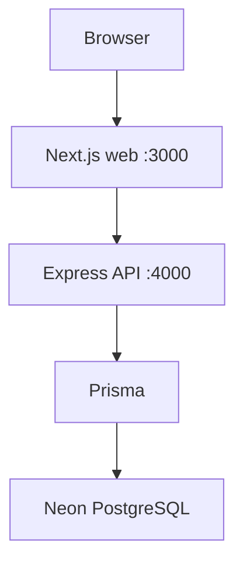

# SkillPulse

India-wide skill-development and labour-market intelligence platform (SIH PS 26134).

**Problem:** Skill programs are hard to align with industry demand when job, curriculum, institute, and placement evidence live in silos — and dashboards often hide uncertainty as zeros.

**Solution:** SkillPulse turns observable labour-market evidence into explainable **government decision signals**, with explicit `INSUFFICIENT_DATA` / UNKNOWN when evidence is missing. It is not a job portal, LLM chatbot, or forecasting engine.

Clerk authenticates identity. Express authorizes application roles and organization scope. Neon stores SkillPulse data via Prisma. See [docs/authentication.md](docs/authentication.md), [docs/data-model.md](docs/data-model.md), and [docs/taxonomy.md](docs/taxonomy.md).

## Architecture

```text
Next.js (apps/web)              http://localhost:3000
        ↓
TypeScript + Express (apps/api) http://localhost:4000
        ↓
Prisma + Neon PostgreSQL
```

The browser talks to the Next.js app. The web app calls the Express API over HTTP (for example `GET /api/v1/auth/me` with a Clerk Bearer token). Prisma runs only inside `apps/api`. Next.js does not connect to PostgreSQL.



### Intelligence pipeline

```text
Sources → Ingestion + Provenance → Job Intelligence → Quality/Trust
→ Demand → Skill Gap → Training → Institute → Employment → Decision
→ Product API → Dashboard
```

Detail: [docs/architecture.md](docs/architecture.md). Maharashtra SIH walkthrough: [docs/maharashtra-demo.md](docs/maharashtra-demo.md), [docs/demo-script.md](docs/demo-script.md), [docs/judge-qa.md](docs/judge-qa.md).

A Python FastAPI process exists at `services/intelligence` (`pnpm dev:intelligence`, [http://localhost:8000/health](http://localhost:8000/health)). It is **not** required for daily web + API work. The Express API does not currently call it.

---

## Running SkillPulse locally

Web and API are **separate development servers**. Run them from the **repository root**. Use two terminals unless you use `pnpm dev` (starts both in parallel).

### Prerequisites

| Tool | Requirement in this repo |
| --- | --- |
| Node.js | `>=20` (`package.json` `engines`) |
| pnpm | `9.15.9` (`packageManager`) |

Verify:

```bash
node -v
pnpm -v
```

Enable pnpm if needed (`corepack enable` or `npm install -g pnpm`).

Python is only needed if you run the intelligence service.

### First-time setup

```bash
cd /path/to/SkillPulse
pnpm install
```

Copy the example env file. Do not commit `.env` or `apps/api/.env`.

```bash
cp .env.example .env
```

Fill in placeholders only. Never put real secrets in Git or in documentation.

| Variable | Used by | Notes |
| --- | --- | --- |
| `NODE_ENV` | API | Default `development` |
| `API_PORT` | API | Default `4000` |
| `NEXT_PUBLIC_API_URL` | Web | Default in code: `http://localhost:4000` |
| `DATABASE_URL` | API / Prisma | Neon PostgreSQL. Required for `/health/db` and Prisma |
| `DIRECT_URL` | listed in `.env.example` | Neon unpooled URL. Prisma schema currently uses `DATABASE_URL` only |
| `NEXT_PUBLIC_CLERK_PUBLISHABLE_KEY` | Next.js | Required for sign-in |
| `CLERK_SECRET_KEY` | Next.js proxy + Express | Server-only. Never prefix with `NEXT_PUBLIC_` |
| `NEXT_PUBLIC_CLERK_SIGN_IN_URL` | Next.js | `/sign-in` |
| `NEXT_PUBLIC_CLERK_SIGN_UP_URL` | Next.js | `/sign-up` |
| `NEXT_PUBLIC_CLERK_SIGN_IN_FALLBACK_REDIRECT_URL` | Next.js | `/dashboard` |
| `NEXT_PUBLIC_CLERK_SIGN_UP_FALLBACK_REDIRECT_URL` | Next.js | `/dashboard` |
| `INTELLIGENCE_SERVICE_URL` | `.env.example` | Intelligence URL; not read by the Express API today |
| `INTELLIGENCE_PORT` | Intelligence | Default `8000` |
| `CORS_ORIGINS` | API | Comma-separated browser origins. Production must not use `*` |
| `JSON_BODY_LIMIT` | API | Request body size limit (default `100kb`) |
| `TRUST_PROXY` | API | Set when behind a reverse proxy |

Do not set `NEXT_PUBLIC_DATABASE_URL` or `NEXT_PUBLIC_CLERK_SECRET_KEY`.

The API loads the **repo-root** `.env`, then a `.env` in the process working directory (`apps/api/.env` when `pnpm --filter api` runs). Next.js `next.config.ts` copies `NEXT_PUBLIC_CLERK_*` and `CLERK_SECRET_KEY` from the root `.env`. `apps/web/lib/api.ts` uses `NEXT_PUBLIC_API_URL`, or `http://localhost:4000` if that variable is unset.

**Neon (first time):** add pooled `DATABASE_URL` (and `DIRECT_URL` if you have an unpooled endpoint). Then apply the migrations already in the repo and seed once:

```bash
pnpm db:migrate
pnpm db:seed
```

Without `DATABASE_URL`, `GET /health` still works and `GET /health/db` returns HTTP 503.

**Clerk (first time):** create a Clerk application and set the two required keys. Restart web and API after changing env. New users are provisioned as `LEARNER`. See [docs/authentication.md](docs/authentication.md).

You do **not** need to migrate or seed every time you start the app.

### Two terminals

CORS on the API allows origin `http://localhost:3000` only. Open the app at that origin (not a different host/port).

**Terminal 1 — API**

```bash
cd /path/to/SkillPulse
pnpm dev:api
```

| | |
| --- | --- |
| Command | `pnpm --filter api dev` → `tsx watch src/server.ts` |
| URL | http://localhost:4000 |
| Port | `API_PORT` (default `4000`) |
| Process health | http://localhost:4000/health |
| Database health | http://localhost:4000/health/db |

```bash
curl -i http://localhost:4000/health
curl -i http://localhost:4000/health/db
```

`/health` does not query PostgreSQL. `/health/db` runs `SELECT 1` via Prisma.

**Terminal 2 — Web**

```bash
cd /path/to/SkillPulse
pnpm dev:web
```

| | |
| --- | --- |
| Command | `pnpm --filter web dev` → `next dev --port 3000` |
| URL | http://localhost:3000 |
| Port | `3000` (set in `apps/web/package.json`) |
| API | Browser → Next.js → `NEXT_PUBLIC_API_URL` (default `http://localhost:4000`) |

Open [http://localhost:3000](http://localhost:3000) in the browser.

Alternative: `pnpm dev` starts web and API together (`pnpm --parallel --filter web --filter api dev`).

### Daily development

```text
Daily development:

Terminal 1:
pnpm dev:api

Terminal 2:
pnpm dev:web

Browser:
http://localhost:3000
```

Run `pnpm db:migrate` / `pnpm db:seed` only when the schema or seed data has changed (for example after pulling new Prisma migrations).

### Verification

Frontend:

```bash
curl -i http://localhost:3000
```

API:

```bash
curl -i http://localhost:4000/health
```

Database (API must be running; `DATABASE_URL` required for HTTP 200):

```bash
curl -i http://localhost:4000/health/db
```

Expected API process health: `{ "status": "ok", "service": "skillpulse-api" }`.  
Expected DB health when connected: `{ "status": "ok", "database": "connected" }`.

### Stopping

In each terminal that is running a dev server, press **Ctrl+C**.

### Database commands

Prisma lives in `apps/api`. Root scripts:

| Command | What it runs | When |
| --- | --- | --- |
| `pnpm db:generate` | `prisma generate` | After schema/client changes, or if the client is missing |
| `pnpm db:migrate` | `prisma migrate deploy` | Apply **existing** migrations in `apps/api/prisma/migrations` |
| `pnpm db:seed` | `prisma db seed` | Load demo + taxonomy seed (upserts; not labour-market evidence) |
| `pnpm db:studio` | `prisma studio` | Browse data in a UI |

Daily `pnpm dev:api` / `pnpm dev:web` does not run these.

### Optional intelligence service

```bash
python -m venv services/intelligence/.venv
# Windows
services/intelligence/.venv/Scripts/activate
# macOS/Linux
# source services/intelligence/.venv/bin/activate
pip install -r services/intelligence/requirements.txt
pnpm dev:intelligence
```

Health: [http://localhost:8000/health](http://localhost:8000/health) → `{ "status": "ok", "service": "skillpulse-intelligence" }`.

### Troubleshooting

**EADDRINUSE: address already in use**

That port is already taken. Often the API or web server is already running in another terminal.

Check whether SkillPulse is already serving:

```bash
curl -i http://localhost:4000/health
curl -i http://localhost:3000
```

If those respond, use the existing process (or stop it with Ctrl+C in the terminal that started it). Do not change ports unless you also change every matching setting (`API_PORT`, `NEXT_PUBLIC_API_URL`, CORS origin `http://localhost:3000`, and `next dev --port 3000`). This repo is set up for **3000** (web) and **4000** (API).

**Missing `.env`**

The API can start without `DATABASE_URL` or Clerk keys. `/health` still returns 200; `/health/db` returns 503 until Neon is configured. Sign-in needs the Clerk keys in `.env` and a process restart.

**Missing dependencies**

From the repo root: `pnpm install`. Python packages are not part of the pnpm workspace; install them only for intelligence (see above).

**Database connection failure**

`/health/db` returns 503 with `"database": "disconnected"` when `DATABASE_URL` is missing or Prisma cannot reach Neon. Confirm the URL is in root `.env` (and `apps/api/.env` if you use one). The Next.js app never receives `DATABASE_URL`.

**Prisma migrate**

`pnpm db:migrate` is `prisma migrate deploy`. It applies migrations already in the repo. It needs a valid `DATABASE_URL`. After pulling schema changes, run `pnpm db:generate` if the Prisma client is out of date.

**Frontend cannot reach the API**

1. API terminal is running (`curl http://localhost:4000/health`).
2. Web is opened at an origin listed in `CORS_ORIGINS` (default `http://localhost:3000`).
3. Dashboard user load calls `http://localhost:4000/api/v1/auth/me` with a Clerk session token. Unauthenticated API calls return 401.

### SIH demo workflow

1. `pnpm install` → configure `.env` → `pnpm db:migrate` → `pnpm db:seed`
2. `pnpm typecheck && pnpm build && pnpm --filter api test`
3. `pnpm dev` → sign in (Clerk) → Overview → Skills → Programs → Decisions → Quality
4. Present using [docs/demo-script.md](docs/demo-script.md). Label synthetic fixtures as **not** official labour statistics.

Seed and sample JSON under `data/sample/` are **SYNTHETIC / DEMO / EVALUATION**. Do not present them as government statistics. Evaluation fixtures must not be treated as live production jobs.

### API

Product intelligence (auth + RBAC): `/api/v1/intelligence/*` — see [docs/api.md](docs/api.md).

Liveness / readiness: `GET /health`, `GET /ready` (DB), `GET /health/db`.

### Evaluation & provenance

Synthetic evaluation datasets live under `data/sample/evaluation/`. Ingestion fixtures under `data/sample/ingestion/` carry acquisition/provenance fields. Phase 7 quality eligibility gates demand and downstream signals.

### NCS job-demand ingestion (Phase 17)

Registered source: `sp.source.ncs` (National Career Service). File/synthetic adapter: `skillpulse-ncs`. Live NCS API is **not** implemented.

```bash
pnpm --filter api ncs:ingest -- --mode synthetic --dry-run
pnpm --filter api ncs:ingest -- --mode synthetic --state Maharashtra
```

Synthetic fixture: `data/sample/ingestion/ncs-maharashtra.sample.json` — **not real NCS data**. Details: [docs/ncs-ingestion.md](docs/ncs-ingestion.md).

### Limitations

- No durable learner/supply registry in MVP; gap and employment need caller-provided observations.
- Course location may be UNKNOWN; never invent institute capacity or placement rates.
- No LLM / forecasting / autonomous policy execution.
- Rate limiting deferred for authenticated single-instance MVP ([docs/deployment.md](docs/deployment.md)).
- Cloud deployment is documented but **not verified in-repo** without an operator-chosen host and credentials.
- Authenticated browser smoke requires a live Clerk session (`SMOKE_BEARER_TOKEN` for API smoke).
- NCS live access is **not configured**; synthetic/file modes only ([docs/ncs-ingestion.md](docs/ncs-ingestion.md)).

### Production deploy

Provider-neutral steps, health/readiness, migrations, smoke test, and Neon recovery notes: [docs/deployment.md](docs/deployment.md). Docker is optional and **not required** for the current Node + Neon + Clerk path.

### Checks

```bash
pnpm test
pnpm lint
pnpm typecheck
pnpm build
# with API running (anonymous + optional token):
npx tsx apps/api/scripts/smoke-production.ts
# optional local baseline (not production capacity):
npx tsx apps/api/scripts/perf-baseline.ts
```
