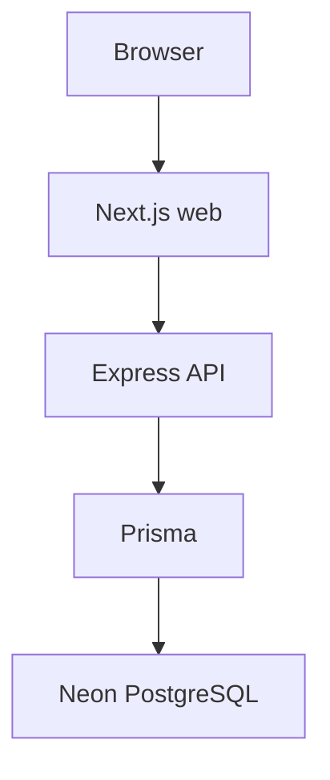

# Architecture

SkillPulse is a modular monolith. Local run instructions are in the [root README](../README.md).

```text
Browser → Next.js (apps/web) :3000
       → TypeScript/Express (apps/api) :4000
       → Prisma → Neon PostgreSQL
```



The web app calls the API over HTTP (`NEXT_PUBLIC_API_URL`, default `http://localhost:4000`). Prisma is used only from `apps/api`.

A FastAPI service exists at `services/intelligence` (`:8000`). It is optional for local web + API development and is not called by Express today.

Phases 1–3 provide local processes, Neon/Prisma, and Clerk authentication with Express RBAC. Phase 4 adds the canonical skill taxonomy (skills, aliases, NCO occupations, sectors and external mappings). Phase 5.1 registers data sources; Phase 5.2 defines a validated job ingestion contract. Source connectors, persistence of ingested jobs, job intelligence and NLP are not implemented yet.
