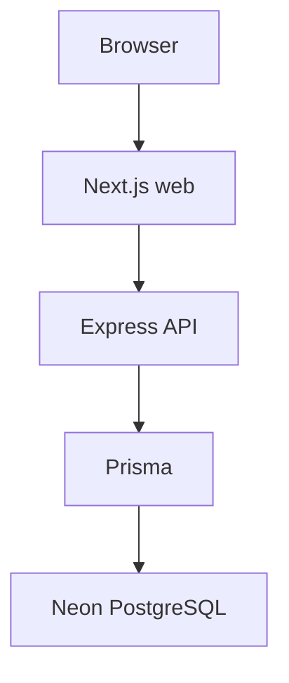

# Architecture

SkillPulse is a modular monolith. Local run instructions are in the [root README](../README.md).

```text
Browser → Next.js (apps/web) :3000
       → TypeScript/Express (apps/api) :4000
       → Prisma → Neon PostgreSQL
```



The web app calls the API over HTTP (`NEXT_PUBLIC_API_URL`, default `http://localhost:4000`). Prisma is used only from `apps/api`.

A FastAPI service exists at `services/intelligence` (`:8000`). It is optional for local web + API development and is not called by Express today.

Phases 1–3 provide local processes, Neon/Prisma, and Clerk authentication with Express RBAC. Phase 4 adds the canonical skill taxonomy. Phases 5.1–5.12 provide source registry through state-agnostic job ingestion. Phase 6 derives **per-job** intelligence from a canonical Job. It does not score market demand, forecast, recommend, or aggregate across jobs.

```text
canonical Job (observed)
        ↓
prepare text → extract skill terms → resolveTerm (Phase 5.9 / 4)
        ↓
requirement signals (REQUIRED / PREFERRED / OPTIONAL / MENTIONED)
        ↓
classify occupation → derive sector
        ↓
parse experience / qualification if caller supplies text
        ↓
JobIntelligenceResult  (optional JobIntelligence row)
```

Phase 6 is state-agnostic and source-agnostic. It does not read `RawIngestionRecord.payload`. Canonical Job has no experience or qualification columns; those parsers accept optional caller-supplied strings and otherwise return UNKNOWN.

### Observed vs derived vs evaluation vs synthetic

| Kind | Meaning |
| --- | --- |
| OBSERVED DATA | Source observation and canonical Job fields |
| DERIVED INTELLIGENCE | Deterministic Phase 6 `JobIntelligence` / `JobIntelligenceResult` |
| EVALUATION DATA | Manually annotated benchmark under `data/sample/evaluation/` — **not** labour-market evidence |
| QUALITY ASSESSMENT | Deterministic Phase 7 `JobQualityAssessment` / analytical eligibility |
| SYNTHETIC FIXTURE DATA | Development/test fixtures such as `data/sample/ingestion/mahaswayam-rojgar.sample.json` — **not** real Maharashtra labour-market evidence |

Phase 6.7 classifies requirement level from the **clause that contains the skill**. Unrelated sentences do not change another skill. Ambiguous wording (`familiarity`, `exposure`, `knowledge of`, bare `Python experience`) stays `MENTIONED`. Stronger local signals win (REQUIRED > PREFERRED > OPTIONAL > MENTIONED).

Phase 6.8 keeps confidence as HIGH / MEDIUM / LOW with evidence (raw term, span, method, source field). Unresolved skills are LOW. Raw ingestion payloads are not copied into intelligence.

Phase 6.9 identity remains `(jobId, processorVersion)` with `JOB_INTELLIGENCE_PROCESSOR_VERSION = "phase6-v1"`. Re-running the same pair upserts one row. A FAILED write never overwrites a PROCESSED result. A new processor version may store a second row.

Phase 6.10 orchestrator is `processJobIntelligence` in `apps/api/src/modules/intelligence/pipeline.ts`. Stage algorithms stay in sibling modules.

Phase 6.11 evaluation dataset and `evaluate.ts` compare expected annotations to derived output. Metrics describe that small EVALUATION DATA set only.

Phase 6.12 runs the Maharashtra **synthetic** fixture through the same state-agnostic pipeline. There is no Maharashtra branch in intelligence modules.

### Phase 7 — Data quality & trust

```text
canonical Job + Phase 5 provenance signals (when available)
        + Phase 6 JobIntelligence (phase6-v1)
        ↓
completeness / source trust / freshness / duplication / intelligence confidence
        ↓
analytical eligibility: INCLUDE | INCLUDE_WITH_CAUTION | EXCLUDE
        ↓
JobQualityAssessment (quality-v1)
```

Phase 7 evaluates data for analytical eligibility. It does **not** aggregate market demand. Freshness and deduplication semantics remain owned by Phase 5. Source trust is registry-based and conservative (`STANDARD` for active registered sources; `UNVERIFIED` when missing/inactive/unresolved). `VERIFIED`/`TRUSTED` are reserved until explicit verification metadata exists.

Reassessment (7.7–7.9) keeps `(jobId, assessmentVersion)` uniqueness: identical fingerprints skip writes; changed inputs nest the prior successful snapshot in `result.previousAssessment`; `quality-v2` coexists as a separate row. Bulk assessment (7.10) is synchronous and bounded. Summary (7.11) counts PROCESSED rows only.

See [data-model.md](data-model.md).

```text
DataSource registry (5.1)
        │
        ▼
source adapter (5.4 / 5.12) → contract (5.2) → ingestJobObservation (5.11)
        → raw (5.3) → validation (5.5) → dedup (5.6) → freshness (5.7)
        → provenance (5.8) → skills (5.9) → canonical Job (5.10)
```

```text
                    STATE-AGNOSTIC CORE
                           │
        ┌──────────────────┼──────────────────┐
        ▼                  ▼                  ▼
   Maharashtra         Gujarat            Karnataka
    adapter             adapter              adapter
   (first impl)        (future /          (future)
                        test fixture)
        │                  │                  │
        └──────────────────┼──────────────────┘
                           ▼
                 Common Job contract
                           ▼
                 ingestJobObservation()
```

A future state is added by registering a DataSource and an adapter that emits the existing contract. The core pipeline must not branch on state names. Named expansion targets (not ingested unless listed as first implementation / test fixture): Gujarat, Karnataka, Tamil Nadu, Telangana, Andhra Pradesh, Kerala, Rajasthan, Madhya Pradesh, Uttar Pradesh, West Bengal, Odisha, Bihar, Punjab, Delhi. See [data-sources.md](data-sources.md).
