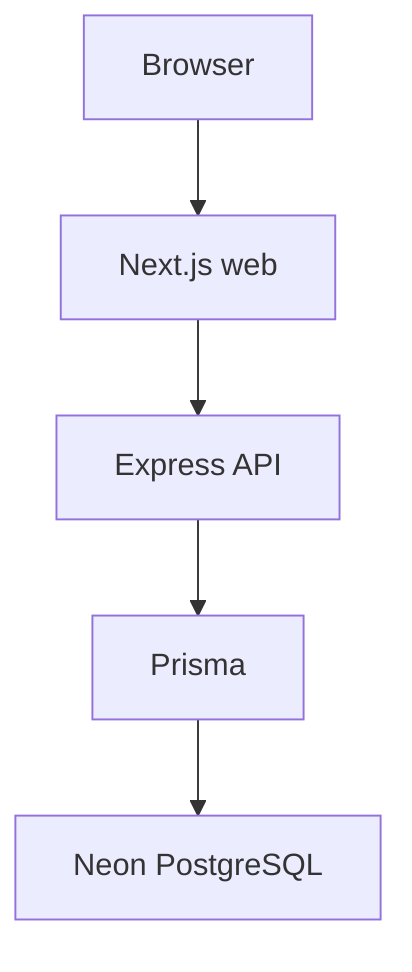

# Architecture

SkillPulse is a modular monolith. Local run instructions are in the [root README](../README.md).

```text
Browser → Next.js (apps/web) :3000
       → TypeScript/Express (apps/api) :4000
       → Prisma → Neon PostgreSQL
```



The web app calls the API over HTTP (`NEXT_PUBLIC_API_URL`, default `http://localhost:4000`). Prisma is used only from `apps/api`.

A FastAPI service exists at `services/intelligence` (`:8000`). It is optional for local web + API development and is not called by Express today.

Phases 1–3 provide local processes, Neon/Prisma, and Clerk authentication with Express RBAC. Phase 4 adds the canonical skill taxonomy. Phase 5.1 registers data sources; Phase 5.2 defines the job ingestion contract; Phase 5.3 stores raw observations; Phase 5.4 maps a test-only fixture through that contract; Phase 5.5 validates contract records; Phase 5.6 classifies duplicate observations; Phase 5.7 classifies freshness. No external source connector, ingested-job persistence, job intelligence, or NLP is implemented yet.

```text
DataSource registry (5.1)
        │
        ▼
raw observation (5.3) → adapter (5.4) → contract (5.2) → validation (5.5) → deduplication (5.6) → freshness (5.7) → later pipeline
```
