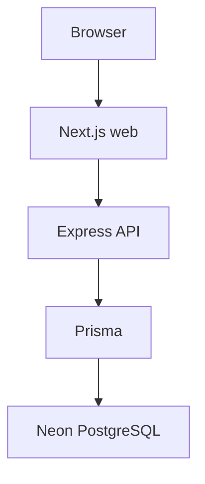

# Architecture

SkillPulse is a modular monolith. Local run instructions are in the [root README](../README.md).

```text
Browser → Next.js (apps/web) :3000
       → TypeScript/Express (apps/api) :4000
       → Prisma → Neon PostgreSQL
```



The web app calls the API over HTTP (`NEXT_PUBLIC_API_URL`, default `http://localhost:4000`). Prisma is used only from `apps/api`.

A FastAPI service exists at `services/intelligence` (`:8000`). It is optional for local web + API development and is not called by Express today.

Phases 1–3 provide local processes, Neon/Prisma, and Clerk authentication with Express RBAC. Phase 4 adds the canonical skill taxonomy. Phases 5.1–5.10 provide source registry through canonical Job persistence. Phase 5.11 orchestrates those stages via `ingestJobObservation`. Phase 5.12 adds a state-agnostic source-adapter layer; Maharashtra is the first implementation, not a Maharashtra-only core. No live external fetch, job intelligence, or NLP is implemented.

```text
DataSource registry (5.1)
        │
        ▼
source adapter (5.4 / 5.12) → contract (5.2) → ingestJobObservation (5.11)
        → raw (5.3) → validation (5.5) → dedup (5.6) → freshness (5.7)
        → provenance (5.8) → skills (5.9) → canonical Job (5.10)
```

```text
                    STATE-AGNOSTIC CORE
                           │
        ┌──────────────────┼──────────────────┐
        ▼                  ▼                  ▼
   Maharashtra         Gujarat            Karnataka
    adapter             adapter              adapter
   (first impl)        (future /          (future)
                        test fixture)
        │                  │                  │
        └──────────────────┼──────────────────┘
                           ▼
                 Common Job contract
                           ▼
                 ingestJobObservation()
```

A future state is added by registering a DataSource and an adapter that emits the existing contract. The core pipeline must not branch on state names. Named expansion targets (not ingested unless listed as first implementation / test fixture): Gujarat, Karnataka, Tamil Nadu, Telangana, Andhra Pradesh, Kerala, Rajasthan, Madhya Pradesh, Uttar Pradesh, West Bengal, Odisha, Bihar, Punjab, Delhi. See [data-sources.md](data-sources.md).
